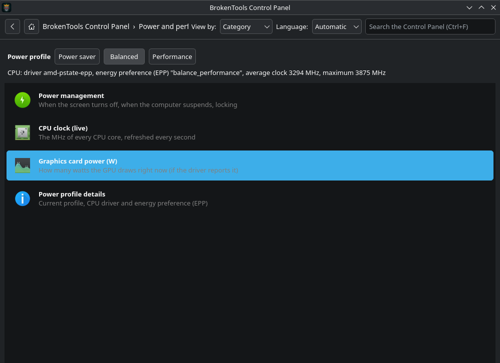

# BrokenTools Control Panel

**A Windows-style Control Panel for KDE Plasma 6 on CachyOS and Arch Linux.**
All your settings and system tools in one searchable window, grouped in familiar categories, so you do not have to remember a command or dig through System Settings for every small task.

<!--
Add screenshots to docs/screenshots/ and uncomment:



-->

## Why

If you come from Windows, the Control Panel is where you fix things. On Linux the same knobs exist, but they are spread over System Settings pages, config files and terminal commands. BrokenTools Control Panel puts the useful ones in one place:

- the real **KDE settings pages** (display, sound, network, power, shortcuts, appearance, ...),
- the **system tools** you normally reach by command (package updates, logs, services, disks, sensors),
- the **CachyOS tools** (Hello, Kernel Manager, mirrors),
- and a **power profile switcher** (Power saver / Balanced / Performance).

It does not replace any of them. It is a launcher: every item opens the real KDE page, program, or a terminal that runs a plain, visible command.

## Features

- **More than 100 items in 10 categories**, shown in a Windows 7 style category view or as one grid of large icons.
- **Search** across all items (`Ctrl+F`), **Back** (`Alt+Left`) and **Home** buttons.
- **Transparent**: an item either opens a KDE settings page (`kcmshell6`), starts a program, or opens a terminal that shows the exact command and waits for you to press Enter. Commands that change the system (updates, installing or removing packages) run in that terminal, so you see them, type your `sudo` password there and confirm in `pacman`. Only the power profile buttons and the "copy info for help" item work without opening a terminal.
- **Adapts to your system**: items whose program or settings page does not exist on your machine are hidden automatically (`--check` tells you why).
- **Power profiles**: switch between Power saver, Balanced and Performance with one click, with a live view of the CPU driver, energy preference (EPP) and clock speed (needs `power-profiles-daemon`).
- **Copy info for help**: one item copies a hardware summary plus your latest system errors to the clipboard, ready to paste into a forum post or a bug report.
- **Fish-friendly**: terminal items run in fish when it is installed, otherwise in bash.
- A single small Python/PyQt6 program. No daemon, no root, no telemetry, and no network access of its own.

## Requirements

| Required | Package (Arch / CachyOS) |
| --- | --- |
| Python 3.9 or newer | `python` |
| PyQt6 | `python-pyqt6` |
| KDE settings launcher (`kcmshell6`) | `kde-cli-tools` |

Recommended: KDE Plasma 6 (`systemsettings`). Many more tools are optional, and each one only enables its own item. See [docs/INSTALL.md](docs/INSTALL.md#optional-packages) for the full list.

Developed and tested on **CachyOS with KDE Plasma 6 (Wayland, fish shell)**. It should work on other Arch-based distributions with Plasma 6. On other distributions it still starts; pacman-specific items are simply hidden.

## Install

```bash
sudo pacman -S --needed python python-pyqt6 kde-cli-tools systemsettings

git clone https://github.com/UnscrewGuru/brokentools-control-panel.git
cd brokentools-control-panel
bash install.sh
```

Then search for **BrokenTools Control Panel** in the application menu. The installer works for your user only (no root) and everything it creates can be removed with `bash uninstall.sh`.

Other ways to install (release archive, Arch package, running without installing) and a step-by-step guide for beginners:

- **[Installation manual](docs/INSTALL.md)**
- **[Tutorial: from zero to your first launch](docs/TUTORIAL.md)**

## Usage

```bash
brokentools-control-panel            # start the window
brokentools-control-panel --check    # show which items are shown or hidden here, and why
brokentools-control-panel --version
```

> **Language:** the interface is available in **English** and **Greek**. By default it follows your system language (`LC_ALL`, `LC_MESSAGES`, `LANG` or `LANGUAGE`; Greek systems get Greek, everything else English). Change it any time with the *Language* box in the toolbar (Automatic / English / Ελληνικά); the choice is remembered. Search finds items in both languages. Other languages are welcome; see [CONTRIBUTING](CONTRIBUTING.md#translations).

## How it works

The whole catalogue is one readable file, [`src/brokentools_control_panel/catalog.py`](src/brokentools_control_panel/catalog.py). Each item is one line:

```python
K("Night Light", "Screen colour temperature by time", ["preferences-system-night-light"], "kcm_nighttime"),   # KDE settings page
A("System Monitor", "Processes, CPU, memory", ["utilities-system-monitor"], "plasma-systemmonitor"),         # program
T("Failed services", "What did not start", ["dialog-warning"], "systemctl --failed", ["systemctl"]),         # terminal command
```

Adding or fixing an item does not need any GUI code. See [CONTRIBUTING.md](CONTRIBUTING.md).

## Roadmap

- More interface languages
- Screenshots in this README
- AUR package
- More items (Flatpak, firewall, backups) and per-distribution catalogues

## Contributing

Bug reports with the output of `brokentools-control-panel --check` are the most useful thing you can send. Pull requests are welcome, see [CONTRIBUTING.md](CONTRIBUTING.md).

## License

GPL-3.0-or-later. See [LICENSE](LICENSE).

## Credits

BrokenTools Control Panel is a [BrokenTools](https://brokentools.org) project by **Unscrew Guru**.
The robot king logo is part of the BrokenTools / UnSpeech artwork.
